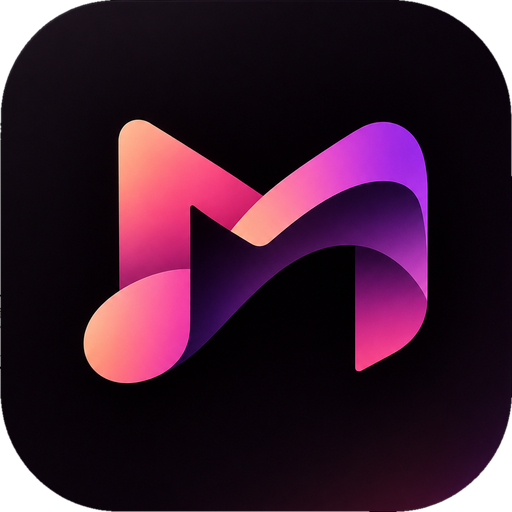
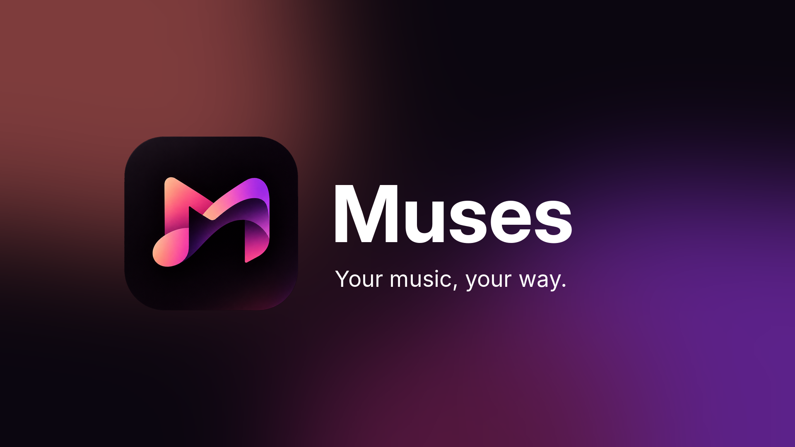

 

# Muses

### Aesthetic YouTube Music Client

 

[**Features**](#features) · [**Download**](#download) · [**Disclaimer**](#disclaimer) · [**License**](#license)

> [!IMPORTANT]
> Muses is not affiliated with, endorsed by, or connected to YouTube or Google in any way. Use it at your own discretion.

---

<h1>Features</h1>

<table>
  <tr>
    <td width="50%" valign="top">

#### Playback
- **Search, browse and play** anything available on YouTube Music.
- **Hi-Res lossless audio** — FLAC/ALAC from a configured module source, with YouTube Music as fallback.
- **Gapless playback with true crossfade**, adjustable 0–12s.
- **Automix [Beta]** — DJ-style transitions with beat-matching and tempo-stretching.
- **Offline downloads** — save tracks with embedded metadata.
- **Local music library** integration.
- **Background playback** via a proper foreground media session.
- **Apple-like lyrics animation** — credit to [binimum](https://github.com/binimum/am-lyrics).

#### Connectivity & Accounts
- **Sign in with your Google account** for personalized content.
- **Spotify integration** — connect your account to play your playlists and Liked Songs.
- **Discord Rich Presence** — in-app login, live track/artist/album and progress.
- **Scrobbling** to Last.fm and ListenBrainz.
- **Pluggable sources** — add, edit, test and health-check module sources.

    </td>
    <td width="50%" valign="top">

#### Experience
- **Animated album canvas** — motion artwork on the now-playing screen.
- **Word-synced lyrics** — word/syllable-level highlighting from multiple sources.
- **Lyrics providers** — credit to [lrc.red](https://lrc.red), [BiniLyrics](https://github.com/binimum), [BetterLyrics](https://github.com/better-lyrics/better-lyrics), [PaxSenix](https://lyrics.paxsenix.org), [LyricsPlus](https://github.com/ibratabian17/YouLyPlus), [SimpMusic](https://github.com/maxrave-dev/SimpMusic), [Unison](https://unison.boidu.dev), [Megalobiz](https://www.megalobiz.com), [KuGou](https://www.kugou.com), [LRCLIB](https://lrclib.net), [Musixmatch](https://www.musixmatch.com) and [Genius](https://genius.com).
- **Dynamic, artwork-driven theming** — Material palette extracted from album art.
- **Frosted-glass UI** — Telegram-style translucent bars via Haze, Material 3 theming.

#### Controls & Tweaks
- **Per-network audio quality** — separate quality ceilings for Wi-Fi and mobile data.
- **Playback speed control** (0.5×–2.0×) and **skip silence**.
- **Sleep timer** — fixed presets or "stop after this track".
- **System equalizer** integration.
- **Stats for nerds** — codec, bit depth, sample rate, and more on the now-playing screen.

    </td>
  </tr>
</table>

---

<h1>Download</h1>

Muses is built from source. For the Windows and Linux desktop app, see [DESKTOP.md](DESKTOP.md).

---

<h1>Disclaimer & Legal Notice</h1>

Muses is an independent third-party audio player and client. It is **not** associated with Google LLC, YouTube Music, Deezer, Telegram, or any of their parent companies.

* **No Media Hosting:** Muses does not host, upload, or store copyrighted music files. It operates strictly as an interface to scan local device storage or stream media directly from public or user-authenticated APIs.
* **Fair Use & API Usage:** This software is created solely for personal research, educational, and fair-use purposes. The user is entirely responsible for ensuring their usage aligns with their local copyright laws and YouTube Terms of Service.
* **Copyleft:** Muses is free software under the GPLv3. Any distribution must come with the Corresponding Source under the same license.

---

<h1>License</h1>

This project is licensed under the **GNU General Public License v3.0 (GPLv3)**. See the [LICENSE](LICENSE) file for details, and [NOTICE.md](NOTICE.md) for where this code comes from.

### Desktop navigation and floating player
The desktop Appearance settings offer **Modern** and **Legacy** interface modes. Modern uses compact Home / Explore / Library navigation, an expanding search field, a floating glass player dock, and a refined home feed with compact Quick picks. Under **Settings → Advanced → Advanced interface customization**, adjust the dock alignment, width, bottom spacing, corner curve, glass contrast, and rim highlight. Legacy restores the classic sidebar layout. The full-screen player remains unchanged; its separate **Player background** setting controls the album-reactive color animation.

For a source-grounded product, architecture, feature, and build guide, see [docs/APP_OVERVIEW_AND_TECHNICAL_GUIDE.md](docs/APP_OVERVIEW_AND_TECHNICAL_GUIDE.md).

Desktop users can open **Settings → Appearance → Advanced customisation** for desktop-only typography, colour, home spacing and artwork, presets, mini-player contents/material, and JSON appearance import/export. Existing desktop shell, Fluidity, player-background, motion, window, and dock settings are reused there. Android settings are unchanged.

