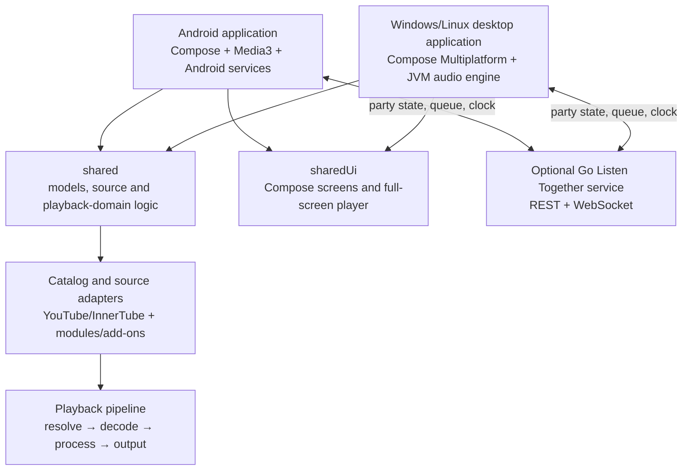

# Muses — Product and Technical Reference

**Repository snapshot reviewed:** 12 November 2026  
**Purpose:** A source-grounded guide for the person maintaining Muses and for AI tools researching or proposing future work.

> This document describes the code in this repository snapshot. It distinguishes implemented behavior from platform-specific, optional, beta, or externally dependent behavior. Service availability, credentials, APIs, and build outputs can change; check the code and current CI before relying on a claim for a release.

## 1. What Muses is

Muses is an open-source music discovery and playback application. It combines a YouTube Music-oriented catalog client with a configurable source system, local and offline music features, lyrics, artwork-driven presentation, and platform integrations. It has an Android application, Windows and Linux desktop applications, and a small optional Go service for synchronized listening parties.

The Android and desktop applications share Kotlin data models, parts of the networking and source layer, and a substantial part of the Compose UI. They do **not** share one playback engine: Android uses AndroidX Media3 and Android platform services; desktop uses a JVM audio pipeline and desktop integrations.

The repository's Gradle project is named **BitChord**, while the product name shown to users is **Muses**. The Android package is `com.music.bitchord`; the development flavor uses `com.dev.bitchord` so it can be installed beside the production app.

Muses is an independent project. It is not affiliated with YouTube, Google, Spotify, Deezer, Telegram, or the other services it can connect to. It is distributed under GPL-3.0; see [`LICENSE`](../LICENSE) and [`NOTICE.md`](../NOTICE.md).

## 2. At a glance

| Area | Current implementation |
|---|---|
| Android | Kotlin Android app; min SDK 26, target SDK 36, compile SDK 37. |
| Desktop | Compose Multiplatform/JVM app for Windows and Linux, built with Java 21. macOS is not a configured target. |
| Shared code | Kotlin Multiplatform modules for data/models and UI shared by Android and JVM targets. |
| Playback | AndroidX Media3 on Android; custom JVM audio engine using FFmpeg/JavaCPP on desktop. |
| Catalog and sources | YouTube Music/InnerTube-based catalog access plus configurable source adapters/modules. Results and streams depend on the source and its availability. |
| Visuals | Compose Material 3, artwork-derived palettes, animated artwork/canvas options, Haze-based blur, custom glass and backdrop effects. |
| Optional server | Go WebSocket service for Listen Together parties. Party state is held in memory; the server has no database. |
| Build system | Gradle 8.11.1 wrapper, Kotlin Gradle plugins 2.3.20. Android is included only when an Android SDK is configured. |

## 3. Platforms and user experience

### Android

The Android app provides mobile navigation and a full-screen now-playing experience. It can keep playback active through a foreground media service, expose controls to Android media sessions and Android Auto, and provide home-screen media widgets. Android-only features include Android media storage access, Cast integration, direct USB audio support, and some device-specific audio routes.

The Android app has production and development product flavors. It requests platform permissions as needed for network access, notifications, audio/media access, foreground playback, Bluetooth audio state, and other platform integrations. The exact permission behavior is governed by the Android OS version and the user's choices.

### Windows and Linux desktop

The desktop app has its own window chrome, system media integration, audio output/device UI, settings, and local music support. Windows uses Windows media controls and the Windows window-frame bridge where available. Linux integrates with MPRIS over D-Bus. Both are JVM desktop builds; macOS is not configured in this repository.

Desktop navigation supports two persisted modes:

- **Modern:** compact Home / Explore / Library navigation at the top, expanding search, profile menu, an artwork-aware home feed, and a floating glass mini-player.
- **Legacy:** the classic sidebar navigation and its previous desktop chrome.

The desktop Modern appearance settings also include advanced floating-player controls: left/center/right alignment, maximum width, bottom spacing, corner radius, glass contrast, and rim highlight. The renderer provides smoked tint, blur, sheen/rim effects, and rounded shapes; it does not implement physical optical refraction or arbitrary drag-and-drop positioning of every icon.

The desktop Appearance page now includes an Advanced customisation editor for desktop-owned appearance values. It supports live typography scaling and bundled/system font-family selection, desktop background black level, contrast-checked fixed accent, artwork-palette strength, Home shelf spacing and lead artwork, the existing Modern/Legacy, Fluidity, blur-reduction, motion, player-background and dock settings, mini-player size/artwork/progress/material/shortcut options, built-in presets, saved user presets, and validated JSON import/export. Existing desktop keys remain the source for settings that already existed. Android appearance controls and Android source files are outside this editor. The current desktop editor does not expose custom fonts/images, full-player/lyrics layout controls, per-control mini-player button ordering, arbitrary navigation rearrangement, or automatic safe-mode launch recovery; physical refraction is not supported by the renderer.

Both desktop modes use the same full-screen player. Its separate Player background setting selects the album-reactive backdrop or the acrylic/glass-style backdrop path. The app also has global Fluidity and Reduce dynamic blur controls. Reduce animation is a separate accessibility/performance preference.

### Listen Together service

The optional Go service allows a small group of devices to share a playback timeline and queue. The client can be pointed at the hosted service or at a user-operated deployment. It is not a streaming relay: each device resolves and plays audio locally using its own account, source, and quality settings.

## 4. What users can do

Feature availability varies by platform, account state, configured source, region, device capabilities, and service API behavior.

| Capability | Android | Windows/Linux desktop | Notes |
|---|---|---|---|
| Home, Explore, search, library, history, queue and full player | Yes | Yes | Shared models and much of the Compose UI; platform details differ. |
| Modern/Legacy shell and advanced floating-dock appearance | No; mobile UI is separate | Yes | Desktop-only settings. |
| Catalog playback and configurable sources | Yes | Yes | Availability and format depend on provider/session/network. |
| Lyrics and artwork-driven presentation | Yes | Yes | Providers/canvases are conditional. |
| Local and downloaded music | Yes | Yes | Android additionally uses device media and SMB/WebDAV-related code; desktop has its own local-file/download path. |
| Spotify library import | Android integration | Not the same library flow | Desktop has Spotify Canvas/artwork code; neither target ships Spotify's playback SDK. |
| Google/YouTube account sessions | Yes | Yes | Session/cookie mechanisms differ by platform. |
| Cast, Android Auto, home-screen widgets | Yes | No | Android/platform integrations. |
| Windows media controls or Linux MPRIS | No | Yes | Windows and Linux use different OS adapters. |
| Listen Together | Yes | Yes | Requires a reachable party server URL and network connection. |
| Last.fm / ListenBrainz scrobbling and Discord presence | Yes | Yes | Optional and account/configuration dependent. |

### Find and browse music

- Browse personalized Home shelves and Explore sections.
- Search catalog items, use filters and suggestions/typeahead, and revisit search history.
- Open song, artist, album, and playlist details where the selected provider supplies them.
- Browse a user's library, playlists, liked songs, listening history, downloads, and local music.
- Use account/channel switching where supported by the connected account.
- Import or browse supported Spotify library/playlist data through the integration. Spotify artwork/canvas integrations are also present. The repository does not include a Spotify playback SDK; do not assume protected Spotify audio is decoded by Muses. Playback is performed through Muses' configured playback sources.

### Play and manage tracks

- Play, pause, seek, skip forward/back, shuffle, and repeat.
- Build and edit queues, add tracks to play next, reorder items, and continue through autoplay/recommendation flows.
- Adjust playback speed; use silence skipping and sleep-timer controls where the platform's playback path supports them.
- Use gapless transitions and adjustable crossfade (0–12 seconds in the product documentation).
- Set separate audio-quality ceilings for Wi-Fi and mobile data on Android.
- Use the system equalizer and Muses audio processing/output options where supported by the device. Android includes direct USB output and lossless-output negotiation paths; output capability depends on the device, DAC, route, and active processing.
- Select a better-quality match or original version when the configured sources provide one.
- See codec, bitrate, sample-rate, and other playback diagnostics through Stats for nerds where available.

### Audio sources and quality

- YouTube Music/YouTube catalog and stream resolution are central source paths.
- The source registry supports built-in and configurable providers. The repository contains source/module machinery, health checks, search and stream calls, quality matching, and add-on handling. A source may be unavailable, rate-limited, region-limited, or return different formats over time.
- Configured module sources can supply higher-quality formats such as FLAC or ALAC when the provider returns them. “Hi-res” is conditional on the source, actual stream format, device output path, and settings; it is not guaranteed for every track.
- JioSaavn-related source support and configurable module/add-on paths are present in the codebase.
- Android includes Media3, HLS/DASH support, a custom FFmpeg decoder path, and device audio routing. Desktop uses FFmpeg through JavaCPP and a custom audio engine. Some output capabilities are platform- and hardware-specific.

### Offline and local music

- Android can download tracks for offline playback and writes supported metadata/artwork into downloaded media. Download formats and tagging depend on the selected stream.
- Android can browse device audio through Android media storage.
- SMB and WebDAV code supports remote file/library access in Android features; WebDAV also includes upload-related code.
- Desktop has local-file/library watching and its own download/cache/persistence paths. Do not assume every Android remote-storage feature has an identical desktop UI.
- Local library items and downloaded tracks are distinct from catalog streams; the local file remains on the user's device or configured storage.

### Lyrics and track presentation

- Fetch lyrics from multiple providers; the code includes timed/LRC and enhanced word/phrase timing paths.
- Align lyrics, adjust offsets, select providers, and translate lyrics where the chosen provider/translation service supports it.
- Display an active lyric line with focused styling and surrounding context; share lyric artwork/cards on supported platforms.
- Show animated artwork/canvas content from available providers. Canvas availability and rights are provider-dependent; a missing canvas falls back to ordinary artwork.
- Artwork colors feed the visual palette and background treatments. Android and desktop have platform-specific rendering implementations.

### Personalization, integrations, and social playback

- Sign in to a Google/YouTube account through the app's account/session flows. On desktop, browser session import is available for supported Chromium-based browser stores; Windows cookie protection uses Windows facilities. These flows do not mean Muses is an official Google client.
- Scrobble listening to Last.fm and ListenBrainz when configured.
- Share Discord Rich Presence when enabled and connected.
- Connect to Listen Together to create/join a party, synchronize playback, and manage a shared queue.
- Android provides Cast, Android media session/Auto integration, media buttons, and home-screen playback widgets.
- Desktop provides OS-level media controls (Windows media session; Linux MPRIS), tray/window controls, and keyboard transport shortcuts.
- View listening statistics/Replay-style summaries and export/share supported recap artwork where implemented.

## 5. Architecture



### Gradle modules

| Module | Responsibility |
|---|---|
| `:app` | Android app shell, Android-specific screens/integrations, Media3 playback service, download and local-media services, widgets, device output, and platform adapters. |
| `:shared` | Kotlin models and shared domain/data logic. `commonMain` holds platform-light models and algorithms; `jvmSharedMain` contains networking/source and JVM-compatible code used by Android and desktop. |
| `:sharedUi` | Compose Multiplatform UI shared between Android and JVM. A substantial part of the screens and full-screen player sits in `jvmSharedMain`; target-specific source sets provide platform behavior/resources. |
| `:desktopApp` | Desktop shell, desktop audio engine, desktop account/source/session adapters, window and OS media integration, native packaging, and desktop-specific UI/settings. |
| `backend/` | Independent Go module for Listen Together. It is not a Gradle module and can be built/tested separately. |
| `native/` and Android C++ sources | Audio analysis, decoder/native bridges, and other native components used by Android and desktop builds. |

### Main playback path

1. A screen or system media control asks the platform playback owner to play a selected `Song`.
2. The source resolver chooses a playable source/format, using account/session state, source preferences, quality ceilings, and available matches.
3. The platform-specific engine opens the stream. Android delegates playback to Media3 and associated custom renderers/processors; desktop opens a decoded audio track through the JVM engine and FFmpeg/JavaCPP.
4. Queue, playhead, playback state, and system media-session state are updated. Track history/statistics, scrobbling, artwork, and presence features observe playback state when enabled.
5. Cache/download systems may retain media or metadata according to the user's action and settings; Muses is not a media-hosting service.

The Android and desktop engines have different capabilities and lifecycle constraints. Shared models and policies do not imply identical codec/output support on both platforms.

### Source/module path

The source layer describes catalog search and stream resolution behind provider interfaces. Source settings can enable, prioritize, test, or health-check configured providers. The module system uses JavaScript runtimes appropriate to the host (QuickJS on Android; GraalVM on desktop) to call user/configured modules. Stream matching associates a catalog song with a provider result; it can fail or select a fallback when metadata differs.

Useful starting points include `shared/src/commonMain/kotlin/com/music/bitchord/data/model/Models.kt`, `shared/src/jvmSharedMain/kotlin/com/music/bitchord/data/YtMusicRepository.kt`, `shared/src/jvmSharedMain/kotlin/com/music/bitchord/data/sources/`, `app/src/main/java/com/music/bitchord/data/sources/`, and `desktopApp/src/main/kotlin/com/music/bitchord/desktop/DesktopModules.kt`.

## 6. Technology stack

Versions below are the pinned values found in the reviewed build files; transitive versions and platform resolution can differ.

| Layer | Technology |
|---|---|
| Main language | Kotlin; Kotlin Multiplatform for shared modules. Go for the party server. C/C++ for selected native/audio-analysis paths. |
| Android UI | Jetpack Compose, Material 3, AndroidX lifecycle/navigation components. |
| Shared/desktop UI | Compose Multiplatform 1.10.3 baseline; JVM UI dependency resolution is deliberately platform-specific. |
| Desktop runtime | Java 21 toolchain; Gradle wrapper 8.11.1. |
| Android playback | AndroidX Media3 1.11.0 (ExoPlayer, session, HLS/DASH and data-source modules) plus project renderers/processors. |
| Network and serialization | Ktor clients, Kotlin coroutines, kotlinx.serialization, OkHttp on Android/shared paths; CIO on desktop paths. |
| Catalog extraction | InnerTubeX and NewPipe Extractor-related code. These are not official YouTube Music SDKs. |
| Artwork and glass | Coil 3 image loading, AndroidX Palette/artwork palette code, Haze blur/materials, custom Compose canvas/mesh/backdrop rendering. |
| Desktop decoding/analysis | FFmpeg/JavaCPP 1.5.12 with FFmpeg 7.1.1 artifacts; ONNX Runtime for Automix models. |
| Android analysis | ONNX Runtime Android and shared/native analysis code. |
| Desktop browser/session support | JavaFX 21 WebKit components, SQLite JDBC for Chromium cookie stores, JNA platform helpers for Windows DPAPI-related handling. |
| Desktop OS controls | D-Bus Java/MPRIS on Linux; Windows media session and native/window bridges on Windows. |
| Listen Together | Go 1.27 module and Gorilla WebSocket; HTTP REST plus WebSocket frames. In-memory party storage. |

## 7. Listen Together service details

The Go service keeps party membership, a shared playback anchor, and a queue in memory. Clients exchange a monotonically sequenced state and queue updates over WebSockets. Clock pings estimate client/server offset; play/seek controls are scheduled slightly ahead so devices can converge on a common start time. Periodic heartbeats re-state the authoritative timeline.

The documented defaults are five devices per party, 25 upcoming tracks, a five-second state heartbeat, a 350 ms play lead, and bounded request/frame/control rates. Party tokens authorize operations after a join, but the server does **not** validate the claimed Google identity with Google. The service is designed as a single in-memory instance; a restart loses active parties, and multiple instances do not share state without a storage/pub-sub change.

Key service files: `backend/main.go`, `backend/party/party.go`, `backend/hub/hub.go`, `backend/clock/clock.go`, `backend/protocol/protocol.go`, and `backend/config/config.go`. The complete route and protocol notes are in [`backend/README.md`](../backend/README.md).

## 8. Persistence, credentials, and privacy boundaries

- Most user settings, playback state, histories, queues, downloads, and caches are stored locally by their platform-specific implementations. Android and desktop do not share one central user database.
- Android account/session storage has encrypted-preferences code. Desktop settings use the OS/JVM preference store; supported browser-session import has platform-specific cookie handling, including Windows DPAPI support.
- Last.fm API key/secret and the optional Listen Together server default are supplied from ignored local properties or environment variables for builds. Signing key material is kept outside source control (`keystore.properties` and the keystore); see `keystore.properties.example`.
- A fresh desktop checkout without Android SDK can still configure desktop targets. Android is included only when an SDK path is configured.
- Listen Together transmits track identity/display metadata, playback timing, queue operations, member identity claims, and party-control events. It does not relay the audio stream or the source's stream URL.
- Do not commit browser cookies, account tokens, local.properties, keystores, passwords, or service secrets. Do not paste them into bug reports or AI prompts.
- Muses relies on online third-party services for many catalog, stream, artwork, lyrics, and integration features. Network requests and service availability are part of normal operation; the client does not host the catalog or media.

The main legal notice is in [`README.md`](../README.md). Users are responsible for following the terms and laws applicable to services and media they access.

## 9. Build, test, and release map

### Prerequisites

- **Android:** JDK appropriate for the Android Gradle Plugin, Android SDK/platforms and build tools through the configured compile SDK, and NDK/CMake for native components. The production signing key is needed for an install-over-existing signed release; it is not included in the repository.
- **Desktop:** JDK 21. Native packaging requires platform tools in addition to Gradle. The Windows workflow installs WiX Toolset 3 and configures MSVC; Linux packaging uses Linux package tools and platform libraries.
- **Backend:** Go 1.27 as declared in `backend/go.mod`.

### Useful commands

```bash
# Shared JVM tests and desktop tests (also used by desktop CI)
./gradlew :shared:jvmTest :desktopApp:test

# Compile desktop and shared JVM UI sources
./gradlew :sharedUi:compileKotlinJvm :desktopApp:compileKotlin

# Run desktop app
./gradlew :desktopApp:run

# Run Android dev unit tests / build dev APK (requires Android SDK)
./gradlew testDevDebugUnitTest
./gradlew assembleDevDebug

# Build the Go service
cd backend
go test ./...
go build ./...
```

On Windows, use `gradlew.bat` and set `JAVA_HOME` to JDK 21 for desktop tasks. Android build commands are conditional on a valid Android SDK. For Windows packages, see [`DESKTOP.md`](../DESKTOP.md); for the Android beta/release signing/version process, see the workflows and Android Gradle configuration.

### CI workflows

- `.github/workflows/check.yml` runs Linux desktop, Windows desktop, Android, and Go checks/builds.
- `.github/workflows/windows-desktop-build.yml` is a manual Windows test/MSI workflow. It runs JVM/desktop tests, sets up JDK 21, WiX, and MSVC, packages the MSI, then checks included native media/session components.
- `.github/workflows/release.yml` handles desktop release packages. Android workflows handle their own APK publication.

Build success is target-specific: a JVM compile does not prove Android packaging, native binaries, installer behavior, or runtime audio-device behavior.

## 10. Where to start when changing a feature

| If the change is about… | Start with… |
|---|---|
| Shared models, song/provider identity, shelves, account/page data | `shared/src/commonMain/kotlin/com/music/bitchord/data/model/Models.kt` |
| YouTube Music catalog or stream resolution | `shared/src/jvmSharedMain/kotlin/com/music/bitchord/data/YtMusicRepository.kt`, `shared/src/jvmSharedMain/kotlin/com/music/bitchord/data/innertube/`, and `shared/src/jvmSharedMain/kotlin/com/music/bitchord/data/sources/` |
| Android playback/service/session | `app/src/main/java/com/music/bitchord/playback/PlaybackService.kt` and neighboring `playback/` classes |
| Desktop audio engine and track transition | `desktopApp/src/main/kotlin/com/music/bitchord/desktop/DesktopAudioEngine.kt`, `DesktopPlayback.kt`, `DesktopAudioPipeline.kt`, and `DesktopPlayhead.kt` |
| Shared Home/Explore/Library/Search or full-screen player | `sharedUi/src/jvmSharedMain/kotlin/com/music/bitchord/ui/` |
| Android-only screen, widget, Cast, Android Auto, or local media | `app/src/main/java/com/music/bitchord/ui/`, `app/src/main/java/com/music/bitchord/widget/`, or the matching `data/`/`playback/` package |
| Desktop shell, Modern/Legacy, player dock, window, or desktop setting | `desktopApp/src/main/kotlin/com/music/bitchord/desktop/DesktopApp.kt`, `DesktopAdvancedAppearance.kt`, `DesktopInterfaceSettings.kt`, `DesktopMiniPlayerAppearance.kt`, and related `Desktop*` files |
| Background/glass/palette | `desktopApp/.../DesktopFluidity.kt`, `DesktopPlayerBackground.kt`, `DesktopArtworkPalette.kt`; Android/shared UI palette/backdrop files under `app/` and `sharedUi/` |
| Lyrics retrieval, alignment, or translation | `shared/src/jvmSharedMain/kotlin/com/music/bitchord/data/lyrics/`, `sharedUi/.../player/PlayerLyrics.kt`, and platform lyrics clients; see [`LYRICS_TRANSLATION.md`](LYRICS_TRANSLATION.md) |
| Audio provider/module/add-on | Android `app/.../data/sources/` and shared models; desktop `DesktopModules.kt`, `DesktopSourceConfig.kt`, `DesktopSourceRegistry.kt` |
| Listen Together UI/protocol/server | shared `data/listentogether/`, Android/desktop party clients, and `backend/` |
| Packaging or release | `desktopApp/build.gradle.kts`, `app/build.gradle.kts`, `DESKTOP.md`, `docs/DESKTOP_RELEASES.md`, and `.github/workflows/` |

## 11. Current limitations and interpretation notes

1. **Catalog and stream availability are not guaranteed.** YouTube Music/InnerTube and third-party provider behavior can change, and modules may stop working. Many network-backed features need a working connection.
2. **Quality is conditional.** A lossless label, source metadata, or output device alone does not prove an end-to-end lossless path. The chosen stream, decoder, processing, Android mixer/device route, and hardware all matter.
3. **Android and desktop are not feature-identical.** The engines, account/session handling, local media access, Cast/system controls, packaging, and some settings differ.
4. **Desktop is Windows/Linux only in this build.** macOS is not a configured target.
5. **Listen Together is not a streaming service.** It coordinates state and queues, trusts identity claims from clients, holds parties in memory, and needs a single instance unless its storage architecture is extended.
6. **Spotify integration is not Spotify audio decoding.** The repository has Spotify library/canvas-related flows but does not ship the Spotify playback SDK.
7. **Glass effects are renderer effects.** Haze blur, smoked tint, palette glow, sheen, rim, and rounded shapes are available; true optical refraction is not.
8. **Automix is marked Beta** in the product feature list and depends on native analysis/model availability and device performance.
9. **Desktop updates are manual.** `docs/DESKTOP_RELEASES.md` states that the desktop app does not show an update prompt; Android has its own update checker flow.
10. **Visual/runtime claims require a target build.** Source inspection and JVM tests cannot prove a Windows MSI installs correctly, a Linux package starts with its native libraries, Android permissions behave on every OS, or a specific DAC provides bit-perfect output.

## 12. Guidance for AI tools using this document

Use this file as an orientation map, not as a replacement for source inspection. Before proposing or making a change:

1. Confirm the feature and target in the current source. Use the platform matrix above to avoid claiming Android behavior exists on desktop or vice versa.
2. Trace a feature from UI to state/model to service/source/engine. Keep UI, source resolution, playback, and persistence responsibilities in their existing layers.
3. Treat external service behavior as conditional and verify current APIs/terms before changing integrations. Never invent stable guarantees for unofficial endpoints.
4. Keep secrets, cookies, signing keys, user media, and local properties out of commits, generated documentation, and logs.
5. Build/test the target that owns the changed code. Native packaging and target-specific runtime checks must be reported separately from Kotlin compilation.
6. Preserve the distinction between implemented features, Beta features, platform-only features, and research ideas. This guide intentionally does not present speculative future features as existing behavior.

### Short context block to give another AI

> Muses is a GPL-3.0 Kotlin music client with Android and Windows/Linux desktop apps, shared Kotlin models/UI, separate Android Media3 and desktop JVM playback engines, configurable catalog/source modules, lyrics/artwork integrations, offline/local features, and an optional in-memory Go Listen Together service. Read `docs/APP_OVERVIEW_AND_TECHNICAL_GUIDE.md` first, then inspect the specific source files it links. Treat provider availability and high-resolution output as conditional, do not assume platform parity, never claim Spotify SDK playback, and do not put credentials/cookies/keystores in code or logs.

## 13. Reference index

- Product summary and feature claims: [`README.md`](../README.md)
- Desktop run/install/build instructions: [`DESKTOP.md`](../DESKTOP.md)
- Desktop release checklist: [`DESKTOP_RELEASES.md`](DESKTOP_RELEASES.md)
- Lyrics translation notes: [`LYRICS_TRANSLATION.md`](LYRICS_TRANSLATION.md)
- Listen Together service/protocol/deployment: [`backend/README.md`](../backend/README.md)
- Android module configuration: [`app/build.gradle.kts`](../app/build.gradle.kts)
- Shared model/network module: [`shared/build.gradle.kts`](../shared/build.gradle.kts)
- Shared UI module: [`sharedUi/build.gradle.kts`](../sharedUi/build.gradle.kts)
- Desktop dependencies and packaging: [`desktopApp/build.gradle.kts`](../desktopApp/build.gradle.kts)
- Android/Linux/Windows/Go CI: [`.github/workflows/check.yml`](../.github/workflows/check.yml)
- Manual Windows desktop test/MSI workflow: [`.github/workflows/windows-desktop-build.yml`](../.github/workflows/windows-desktop-build.yml)
